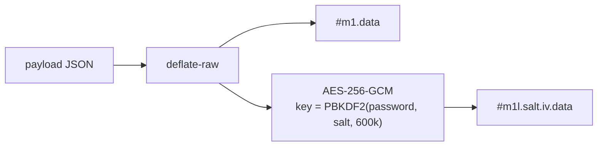

# Feature: Moin Domi D0 — the link format and foundations

## Problem
`DOMI_ROADMAP.md` (approved 2026-10-30) starts with D0: a normative link format, a pure library
with negative fixtures, and an app scaffold deployed beside the puzzle. Everything Domi does in
D1 (compose, share, unlock, receive, pass on, fade) stands on these bytes, so they come first and
are tested in all three browser engines.

## Design

- **`docs/DOMI_FORMAT.md`** is normative: fragment grammar, payload keys and rules, encoding,
  locking, the seven reader errors, fading, known limits.
- **`packages/domi-link`** (TypeScript, strict): `encode`, `lock`, `read` (open → Moin; locked →
  needs a password), `unlock`, `passOn`, `validate`, `fadesOn`/`hasFaded`, `holderNumber`.
  Randomness (salt, IV) is **injected** (`random: (n) => Uint8Array`), so tests are exact and the
  library has no hidden I/O; WebCrypto and `CompressionStream` are the only platform calls.
- **Negative fixtures** in `packages/domi-link/fixtures/` — one file per failure the roadmap
  names: unknown version, tampered ciphertext, wrong password, too long, too many words,
  malformed base64, a hop list that doesn't match its count. Each must fail with its message.
- **Cross-engine gate** (`apps/moin-domi/e2e/link.spec.ts`): the library bundled into each
  browser makes a locked ten-hop Moin; Node opens it; a Node-made Moin opens in the browser. Runs
  in Chromium locally, in Chromium, Firefox and WebKit in CI.
- **`apps/moin-domi`**: Svelte 5 + Vite scaffold, the painted harbour and one honest card ("being
  built"); same CSP as the puzzle; built to `<base>/domi/` and copied into the puzzle's Pages
  output by `scripts/assemble-site.mjs`. The puzzle's service worker gets a
  `navigateFallbackDenylist` for `/domi/`, so it never serves the puzzle there.

## Risks
- **DEFLATE differs between engines** — the spec and test require interoperable inflate, never
  byte equality.
- **PBKDF2 at 600 000 iterations** costs ~0.3–1 s per lock/unlock on a phone *(predicted)*;
  measured in D1 on a real device, never lowered silently (it is in the format).
- **Same origin as the puzzle**: Domi shares the puzzle's IndexedDB origin. D1 must use its own
  database name (`moin-domi`), never the puzzle's `moin`.
- **The puzzle's service worker** controls `/MoinMoinMoin/`; without the denylist it would answer
  `/domi/` with the puzzle. A test reads the built `sw.js`.

## Gaps (D1 and later)
Compose, share, unlock, receive, pass-on screens; offline for Domi; the harbour office (D2).

## Test matrix
| Case | Expected |
|:--|:--|
| open Moin round trip | `read(encode(m))` equals `m` |
| locked round trip | `unlock(lock(m, pw))` equals `m`; wrong password → `wrong-password` |
| pass on | `n + 1`, name appended while < 24; locked stays locked with a fresh salt and IV; `p = 0` → `closed` |
| 24-name cap | 30 holders: `h` keeps 24, `n = 30` |
| validation | each rule in FORMAT §2 rejected with its field named |
| fading | day/week/month boundaries; a Moin on its last day is not faded |
| size | locked, ten hops, 80-char words, 24-char names → < 2 000 characters |
| fixtures | seven files, each fails with its message |
| cross-engine | browser-made → Node opens; Node-made → browser opens (Chromium here; +Firefox, WebKit in CI) |
| scaffold | `<base>/domi/` serves Domi, not the puzzle; no request off the origin |
| puzzle SW | built `sw.js` denies navigation fallback for `/domi/` |
