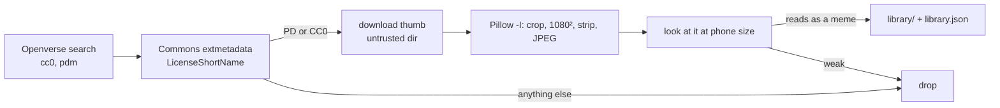

# Feature: an open-licensed meme template library (`packages/assets/library`)

## Problem
The owner asked to "research online, download memes". Famous meme photos (Distracted Boyfriend,
Grumpy Cat, Drake…) are copyrighted photographs, often of identifiable people and sometimes
trademarks: shipping them would break CLAUDE.md §1 ("original assets only") in spirit and the law
in fact. The legal version of the wish is a small library of **backgrounds that nobody owns**:
public-domain paintings and photographs, and photographs whose authors waived their rights (CC0).
Domi's six night paintings (`look.ts` `PAINTINGS`) also run out quickly in a chain of six.

## Design
- **Content**: ~24 square backgrounds, leaning to the North Sea, the harbour and art history so
  they sit beside the generated Monet-like paintings: Friedrich, Turner, Monet, Bruegel, Hokusai,
  Dutch Golden Age (Rijksmuseum CC0), plus a few CC0/PD animal photos (gulls, seals, a cat) and one
  NASA photo. Chosen for comic potential first: a figure to project onto, a situation, room for a
  top and bottom caption.
- **Licence rule**: *Public domain* or *CC0 1.0* only, **read per file from the source's own
  metadata** (Wikimedia Commons `prop=imageinfo&iiprop=extmetadata` → `LicenseShortName`; Openverse
  `license` for discovery only). Never from memory, never "it's old so it's fine".
- **Files**: `library/<id>.jpg` — centre (or focus-point) crop to square, 1080 × 1080, progressive
  JPEG quality ≤ 78, every metadata segment stripped (a fresh image is built from pixels only),
  ≤ 180 KB target, ≤ 200 KB enforced.
- **Credits**: `library/library.json` — `{ id, title, creator, year?, license, source, tags }`. The
  app shows title and creator; `source` is the Commons landing page where the licence can be
  re-checked. Credit is given even where PD/CC0 does not require it (courtesy, and it lets anyone
  audit the claim).
- **Exports**: `@moin/assets/library/*` like `./art/*`. Wiring into Domi is the lead's job (not
  here): a `where`-like id in the meme value, the image bundled with the app, never uploaded —
  the relay still sees only sealed ids (MOIN_DOMI D1/D4).

## Risks
- **"Public domain" differs by country.** EU: author's death + 70 years; US: published before
  1931 (as of 2026), or a US federal work. A painting by an artist dead > 70 years that was first
  published late can still be protected in the US. Every painting here is pre-1900 or the artist
  died before 1956, and was published long before 1931. Faithful photographs of 2D public-domain
  art are not new works in the US (*Bridgeman v. Corel*) or in the EU (DSM Directive Art. 14) —
  but the UK and some museums disagree historically; Commons' `PD-Art` tag carries that warning.
- **"No known copyright" is not CC0.** Flickr "Public Domain Mark" set by an uploader is a claim,
  not a waiver: an uploader can mark someone else's photo. Only PDM on works that are PD for an
  objective reason (age, US government) and CC0 set by the author are accepted.
- **Personality and trademark rights survive copyright.** No identifiable private person in a
  modern photo, no logos, no brands. Painted people dead for centuries are fine.
- **Meme humour can be cruel.** Images carry no text; captions are the players'. Nothing violent
  or sexual is in the set, so the template itself never sets up a cruel joke.
- **Commons rate limits** (429 to bursts): one request every 3 s with a descriptive User-Agent.
- **Size**: 24 × ≤ 200 KB ≈ 4 MB in the repository. Not precached by the puzzle; Domi decides.
- **D1 conflict**: MOIN_DOMI D1 says "templates are our own cast only". The library is shipped
  content, not uploads, so the reason for D1 (no copyrighted images, no media on the relay) still
  holds — but D1's wording needs an amendment before the lead wires it in.

## Test matrix (`packages/assets/test/library.test.ts`)
| Happy day | Bad weather |
|:--|:--|
| every entry has a file, every file an entry | a stray `.jpg` without an entry, or an entry without a file, fails |
| ids unique, kebab-case | duplicate id, `Great_Wave`, `great--wave` fail |
| licence is `Public domain` or `CC0 1.0` | `CC BY-SA 4.0`, `pdm`, `public domain` (case) fail |
| source is an https URL | `http:`, empty, not a URL fail |
| each file ≤ 200 KB, JPEG SOF says 1080 × 1080, progressive | PNG bytes, truncated JPEG, 1080 × 1079, baseline JPEG fail |
| no APP1 (EXIF/XMP) or APP13 (IPTC) segment | a file with EXIF fails |
| only the known keys | an extra key (e.g. `url`) fails |
| the header reader reads a hand-made SOF0 | non-JPEG and truncated bytes return null |

## In the app (2026-11-20, `feature/domi-library`)
- *Make the meme* → **From the library**: a scrolling row of 24 tiles (lazy-loaded), a radio group
  named by each title; the chosen one's credit (title, creator, year, licence) under it. Picking
  one sets `template`, drops an own picture, and starts with *Nobody* in front; a painting tile
  drops it again. Allowed in chains, postcards and **public posts** (nobody owns them).
- Rendering, *Save image* and the screen-reader label ("over “The Scream”") know `template`; an
  id this build lacks leaves the ground black rather than failing.
- **Not precached** (3.6 MB): the worker caches each library file the first time it is shown
  (`CacheFirst`, `domi-library`, 40 entries). Precache stays at 29 entries, 1.28 MB.
- *About and the rules* → **Pictures from the library**: all 24 credits with their Commons source,
  behind *All 24 pictures and their sources*, each a 44 px row link.

### Evidence
Domi e2e `library.spec.ts` 3 (pick with credit → chain → next stop decodes the 1080 px image; a
painting drops it; a library meme posts publicly; About: 24 credits, licence and source each,
≥ 44 px); `domi.spec.ts` About tap-target check caught the first, too-small credit links.
