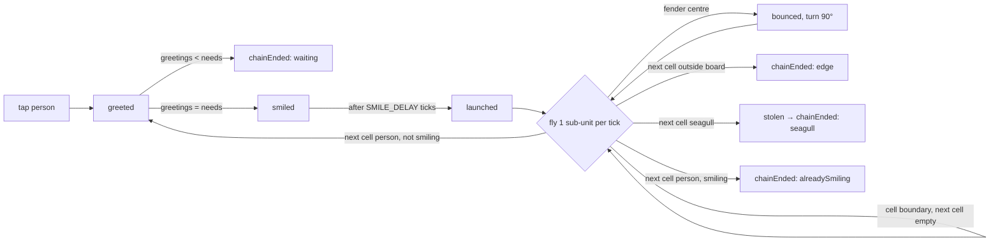

# Feature: the physical model (design round → GAME_RULES v1)

## Problem

`docs/GAME_RULES.md` v0 is a grid model: a greeting reaches only the adjacent square. It is
deterministic and solvable but there is nothing to *watch*: the Moin teleports one square. The
target (CLAUDE.md §1, §4) is a Moin that moves through the harbour like a real thing — travels,
bounces, gets blocked — while staying fully deterministic so that par, the solver and a future
daily level stay fair.

## Options weighed

| Option | Watchable | Deterministic | Solver | Verdict |
|:--|:--|:--|:--|:--|
| A. Free 2-D physics (velocity, angles, circles) | very | only with fixed-point trig tables, replay risk on every engine | search over continuous aim — no exact par | rejected: par cannot come from a solver |
| B. Grid v0, animated | barely (one-square hop) | yes | yes | kept as fallback |
| C. **Grid-aligned flight on a fixed step** | yes: the Moin flies over open water, bounces off fenders, is stolen by gulls | yes: integer sub-cell positions, one integer step per tick, no transcendental functions at all | yes: flight paths are static, so R9 (order does not matter) survives | **chosen** |

Option C keeps the parts both models share (CLAUDE.md §4) and replaces only R3 (adjacent only)
with *line of flight*, and adds one physical object, the **fender** (a slanted harbour fender
board that deflects the Moin by 90°).

## Design

- Space: one cell = 12 sub-units. A Moin is a point at integer sub-unit coordinates.
- Time: 60 ticks per second; a Moin moves exactly 1 sub-unit per tick (0.2 s per cell).
- The simulation is a real fixed-step loop in `core` (not a closed-form shortcut) so a later
  mechanic that moves (the parked ferry) has somewhere to live. Every number in the hot path is a
  small integer; there is no `Math.sin`/`cos`/`sqrt` anywhere in `core` (lint-enforced).
- Every event carries its tick `t` and, for Moin events, the sub-unit point `px, py`. The UI
  interpolates linearly between consecutive Moin events and decides nothing.

## Termination

Each person starts smiling at most once and only that moment launches a Moin, so a tap launches at
most `people` Moins one after another (never two at once). A single flight is a walk over
`(cell, direction)` states. The fender reflection is a bijection on those states, so a walk that
started from a person's cell cannot enter a cycle of empty/fender cells: the first repeated state
would need two different predecessors. The walk therefore ends within `4 × width × height` cell
crossings. `core` still carries a hard step cap that throws (it must never fire; a test proves
it is unreachable on random boards).

## Risks

- **Line of flight makes levels easier** (a Moin reaches far). Mitigated by seagulls and fenders;
  `validate:levels` reports first taps leading to par (CLAUDE.md §8).
- **Every level is solvable** (tap everyone to `needs`). "Unsolvable" can only mean "no people".
  Recorded in `.agents/lessons/puzzles.md`.
- **Order still does not matter** (R9 survives). Puzzles stay "where", not "when". The roadmap's
  answer (the chatterbox, Phase 2) is unchanged.

## Gaps

- Not playtested (Phase 0 gate "fun to watch five times in a row" is a human gate).
- The replay test runs on Chromium locally; Firefox and WebKit run only in CI.

## Test matrix

| Case | Kind | Expected |
|:--|:--|:--|
| tap empty square / seagull / fender | bad weather | `[]`, state unchanged, no tap counted (R1) |
| tap smiling person | bad weather | `[]`, no tap counted (R2) |
| tap person needs 1 facing edge | happy | greeted, smiled, launched, chainEnded edge at board boundary |
| Moin over two empty cells into person | happy | greeted at `t = SMILE_DELAY + 6 + 2×12` |
| Moin into seagull | happy | stolen then chainEnded seagull, seagull stays (R4) |
| Moin into fender `/` going east | happy | bounced north at fender centre |
| fender loop back to the sender | edge | chainEnded alreadySmiling |
| captain greeted once | happy | chainEnded waiting; half-greeted persists across taps (R5) |
| Moin into smiling person | edge | chainEnded alreadySmiling, no greeting added |
| random boards, random taps | property | ≤ people smiles per tap, every tap ends with exactly one chainEnded per chain, step cap never hit |
| random tap sequence vs shuffle | property | identical final state (R9) |
| solver par vs brute force over sequences | property | equal on small random boards |
| recorded solution replay | determinism | identical events in Node, Chromium, Firefox, WebKit |
