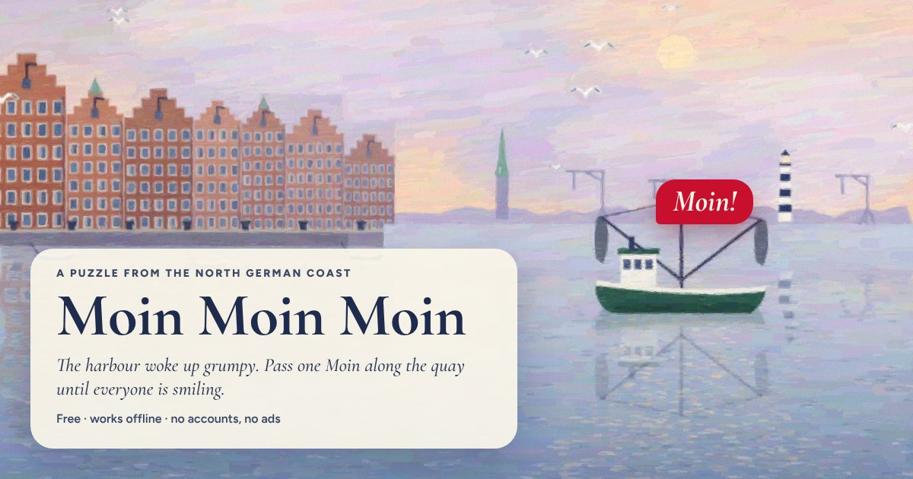

# Moin



Two tiny games around the northern German greeting *Moin*. **Moin Moin Moin** — a harbour puzzle
PWA: tap a grumpy person, watch the *Moin* fly, bounce off fenders, get nicked by seagulls, until
everyone smiles. **Moin Domi** — a private Stille Post for memes; specified in
[`docs/MOIN_DOMI.md`](docs/MOIN_DOMI.md), not built yet.

Play: <https://mncopilotuno.github.io/MoinMoinMoin/>

```bash
pnpm install --frozen-lockfile
pnpm --filter @moin/moin-moin-moin dev   # http://127.0.0.1:5173
pnpm test && pnpm validate:levels && pnpm test:e2e
```

Read [`CLAUDE.md`](CLAUDE.md), [`HANDOVER.md`](HANDOVER.md), [`docs/ROADMAP.md`](docs/ROADMAP.md)
and [`docs/GAME_RULES.md`](docs/GAME_RULES.md).
